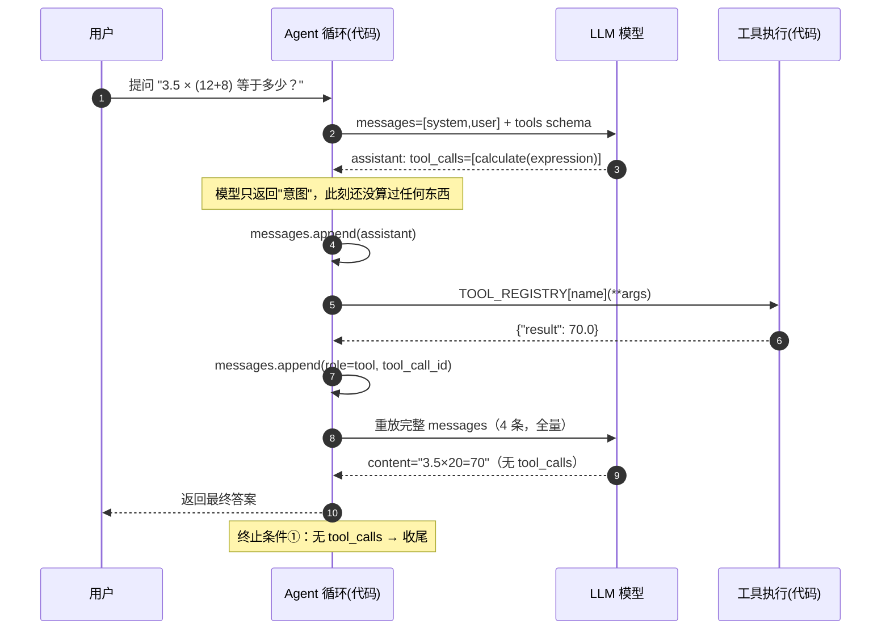

# 第 4 节 · 裸写 Agent 主循环（不用任何框架）

> 系列：「30 天把自己重训成 Agent 工程师」· 代码仓库版
> 前一天：第 3 节 · 什么时候需要升级到 Agent（待产）
> 后一天：[第 5 节 Function Calling 与工具设计](../day05-function-calling)

## 学习目标
1. 理解 **LLM / Tool / Agent / Environment** 四者的关系
2. 掌握一次 Agent 执行的**完整生命周期**：调用 → 解析 tool_call → 执行 → 回灌 → 再请求
3. 看懂模型返回 `tool_calls` 后，**应用层如何执行工具并回传结果**
4. 吃透三类**终止条件**：无工具调用 / 达到最大轮次 / 上下文预算熔断

## 资料
- [OpenAI Function Calling](https://platform.openai.com/docs/guides/function-calling)
- [Anthropic · Building Effective Agents](https://www.anthropic.com/engineering/building-effective-agents)

## 本日产出
| 文件 | 说明 |
|---|---|
| `day1_agent_loop.py` | 裸写 Agent 主循环（Mock 离线 + 真实 API 双模式，零依赖，`python3 day1_agent_loop.py`） |
| `Day1-Agent主循环时序图.html` | 交互式时序图（本地浏览器打开 / 公众号用，可步进看 messages 演化） |

## 验收标准（均已在演示中跑通 ✅）
- ✅ 能完成至少一次工具调用和两轮连续工具调用（场景 A / C）
- ✅ 模型返回错误参数时，不发生程序崩溃（`execute_tool` 永不抛异常）
- ✅ 达到最大轮次时能返回明确的终止状态（终止条件②）
- ✅ 工具执行失败，由应用层转成「可读 error」回灌，模型有机会自我纠正（场景 B）

## 核心心智模型

### 1. Agent 本质：一个无状态的 while 循环
```
while True:
    resp = LLM(messages, tools)        # 模型决策
    if resp 没有 tool_call: break       # 终止①：自然收尾
    for call in resp.tool_calls:
        result = execute(call)          # 真正干活的是本地代码
        messages.append(tool 结果)       # 回灌给模型看
    if 轮次超限: break                  # 终止②：防死循环
```
**模型只负责「决策调哪个工具、传什么参数」，执行永远发生在你自己的代码里。**
这句话面试时说出来很加分。

### 2. 三类终止条件各防什么
- **① 无 tool_calls → 正常收尾**：模型认为信息够了，给出最终回答。
- **② 轮次上限（MAX_ROUNDS）→ 防死循环**：模型若一直要工具，硬截止并上报/转人工。
- **③ 上下文预算（MAX_TOTAL_CHARS）→ 防 token 爆炸**：真实场景此处应做摘要压缩，而非直接放弃。

### 3. execute_tool 为什么永不抛异常
抛异常会直接杀死循环；转成可读的 `error` JSON 回灌，模型才有机会**自我纠正**
（场景 B：查「纽约」失败 → 模型下一轮主动换成「杭州/上海/北京」）。

### 4. tool_call_id 是强契约
工具结果必须带 `tool_call_id` 以 `role=tool` 回灌。少了它，模型无法把「结果」和
「请求」配对——并行调用时会直接串味，是最常见的低级 bug。

> 注：本日用 `calculate` + `get_weather` 两个工具做演示（而非计划大纲里的占位名
> `calculator` / `competitor_search_mock`）。工具名只是示意，核心是循环结构；
> 天气「报错→自纠」的演示比竞品查询更直观，便于第一天建立直觉。

## Agent 主循环时序图（GitHub 原生渲染）


> 想看逐步动画版（可步进、看 messages 数组如何变长），打开 `Day1-Agent主循环时序图.html`。

## 面试题（Day 01）
1. **Agent 和普通 LLM Chat 有什么区别？**
   要点：Chat 只生成文本；Agent 在「生成」之外多了**工具执行 + 结果回灌**的闭环，能作用于真实世界（算钱、查库、调 API）。
2. **Agent Loop 的核心流程是什么？**
   要点：组装 messages+tools → 调模型 → 若有 tool_calls 则执行并回灌 → 循环直至无 tool_calls。
3. **如何防止 Agent 无限循环？**
   要点：轮次硬上限、Token/上下文预算、显式完成信号；配套靠「重复工具调用检测」与「可观测 trace」。
4. **工具执行失败后，应该由模型重试还是应用层重试？**
   要点：应用层先做**确定性重试**（超时/5xx/幂等键），只有「参数层面」的错误才把可读 error 回灌给模型，让它决策是否换参数或换工具——不要一股脑把重试交给模型。
