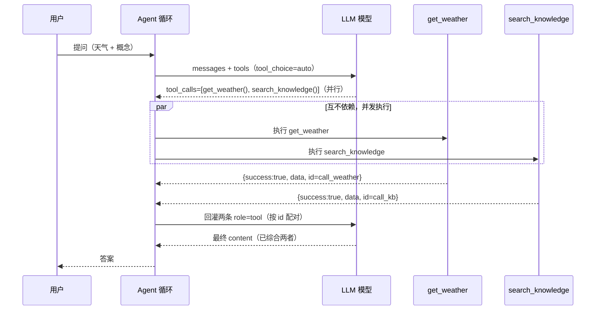

# Day 02 · Function Calling 与工具设计

> 系列：「30 天把自己重训成 Agent 工程师」· 代码仓库版
> 前一天：[Day 01 裸写 Agent 主循环](../day1)
> 后一天：[Day 03 MCP 协议与工具接入架构](../day3)（待产）

## 学习目标
1. `tool_choice` 的 `auto` / `required` / 指定工具 三种模式分别解决什么问题
2. JSON Schema 参数校验：在「执行前」拦掉坏参数
3. 并行工具调用与串行依赖的区别
4. 结构化输出（structured output）与工具调用的区别
5. 工具粒度怎么设计：按 API 还是按业务动作

## 资料
- [OpenAI Function Calling](https://platform.openai.com/docs/guides/function-calling)
- [Pydantic](https://docs.pydantic.dev/)

## 本日产出
| 文件 | 说明 |
|---|---|
| `agent/tools/registry.py` | 工具注册中心 V0：注册 / Schema / 校验 / 并行执行 / 统一结果 |
| `agent/tools/__init__.py` | 包导出 |
| `day2_function_calling.py` | 可运行演示，覆盖四个验收点（零依赖，`python3 day2_function_calling.py`） |
| `sequence.html` | 交互式并行调用时序图（本地浏览器打开，公众号用） |

## 验收标准（均已在演示中跑通 ✅）
- ✅ 参数缺失、类型错误、非法枚举值都能被「执行前」拦截
- ✅ 并行工具结果能正确对应原始 `tool_call_id`
- ✅ 工具错误不会直接暴露内部堆栈给模型或用户
- ✅ 统一结果格式 `success / data / error / retryable`

## 核心心智模型

### 1. tool_choice 只是「请求构造」的差异
```
payload["tool_choice"] = "auto"                                  # 模型自己决定
payload["tool_choice"] = "required"                              # 必须返回一个 tool_call
payload["tool_choice"] = {"type":"function","function":{"name":"get_weather"}}  # 锁定单工具
```
- `required`：这步「一定得落地一个动作」时用（如强制走工具取数）
- 指定工具：流程已锁定下一步时用
- 它们不改变「执行层」，只改变「模型决策约束」

### 2. 校验在执行之前，不在工具内部
坏参数（缺字段 / 类型错 / 非法枚举）在 `registry.execute` 里就拦下，
根本不会进到工具函数。好处：工具内部只处理「合法输入」，逻辑更干净，
也避免把校验错误伪装成业务错误。

### 3. 并行调用靠 tool_call_id 配对
模型一次返回多个 `tool_calls`，你并发执行后，**每个结果必须带上原来的
`tool_call_id`** 以 `role=tool` 回灌。丢了 id，多结果就会串味——这是最常见的低级 bug。

### 4. 统一结果 + 错误隔离
所有工具收口成同一结构 `{success, data, error, retryable}`：
- 模型解析稳定
- 调度层能据 `retryable` 决定是否重试
- 工具内部崩了，只回「可读错误 + 可重试」，traceback 写日志，**绝不回灌**

## 并行调用时序图（GitHub 原生渲染）


## 《工具设计规范》一页
1. **名字动词化**：`get_weather` / `search_knowledge`，不要 `weather_data`
2. **描述写清「何时用 / 何时不用」**：模型靠 description 决定调不调，含糊的描述 = 误调用
3. **参数用 JSON Schema 严格约束**：required / type / enum 写全，校验放执行前
4. **错误信息写给模型看**：说清「错在哪 + 怎么改」，而不是抛堆栈
5. **粒度按业务动作，不按 API**：`book_and_pay` 比拆成 `book` + `pay` + 手工编排更稳，
   但别把整个流程塞进一个工具——失去组合性
6. **结果统一收口**：所有工具返回同一结构，便于解析与重试
7. **执行层做鉴权与隔离**：权限、超时、错误吞栈都在注册中心，不在每个工具里散落

## 面试题（附要点）
1. **如何设计一个模型不容易误用的工具？**
   动词化命名 + 描述写清边界 + JSON Schema 严格约束 + 执行前校验 + 可读错误。
2. **Function Calling 和普通 HTTP API 有什么区别？**
   普通 API 是你写死调用；Function Calling 是模型读 schema 后**自己决定**调不调、传什么参。
   工具代码是确定的，模型只出意图。
3. **并行工具调用有哪些风险？**
   `tool_call_id` 配对错误导致结果串味；共享可变状态竞态；某个慢工具拖垮整体（需超时）；
   副作用工具并行可能重复（需幂等）。
4. **工具粒度应该按 API 还是业务动作设计？**
   优先按**业务动作**（一次模型决策完成一件事），但保持可组合；
   纯 CRUD 才贴近 API。避免「一个工具干完整个流程」失去灵活性。

---
由 `day2_function_calling.py` 自动演示生成配套说明；改代码后重读即可。
